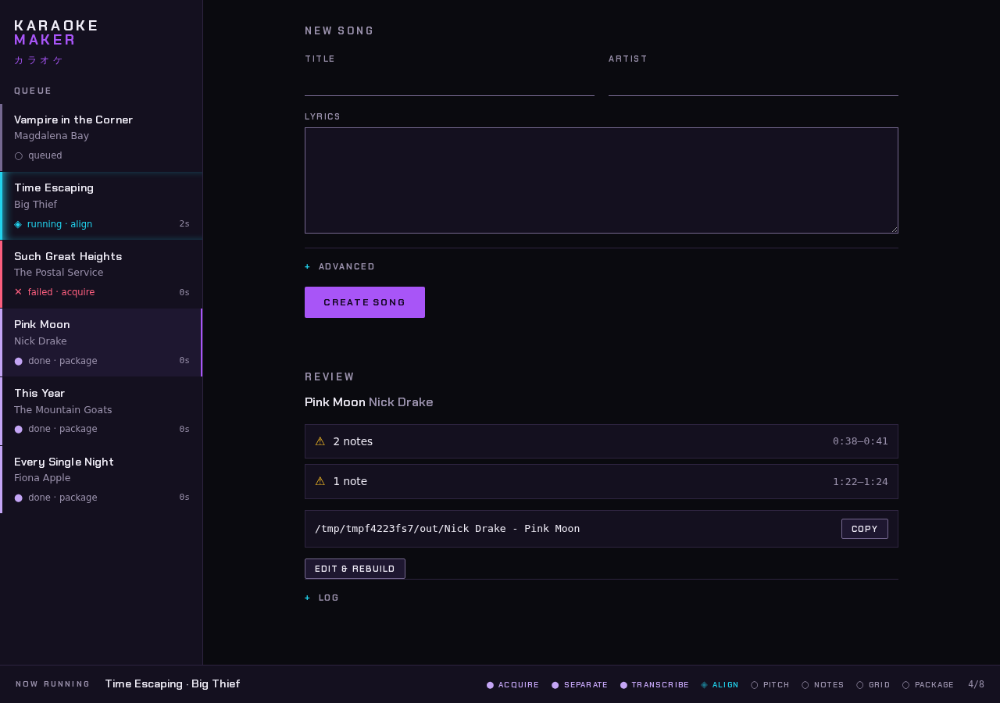

# songtrace

> **This is a read-only mirror.** songtrace is developed on a private forge,
> and issues and pull requests are not accepted here.

Self-hosted karaoke chart builder for [UltraStar](https://usdx.eu/format/) and
compatible games such as [Melody Mania](https://melodymania.org/). Give it a
song's video and lyrics and it charts the notes, timing and pitch, ready for
your collection. Fix anything in the built-in editor; your edits survive when
you rebuild your whole collection after a songtrace update.



## What it does

You give it a title, artist, the lyrics, and a YouTube URL or a video file.
songtrace writes a song folder (`.txt` chart, `.mp3`, video and cover) into
your collection:

1. **acquire**: downloads the video with `yt-dlp`, or takes your file
2. **separate**: splits vocals from the backing track (Demucs)
3. **transcribe**: has your Whisper server transcribe the vocals, to check
   the lyrics match the recording and to find where the singing is
4. **align**: places each word of *your* lyrics on the vocals (wav2vec2)
5. **pitch**: tracks the sung pitch (torchcrepe)
6. **notes**: turns word timings and pitch into notes
7. **grid**: snaps the notes to a beat grid
8. **package**: writes the song folder

The result is a strong draft, not a finished chart. The web UI flags the notes
it is least sure of, plays the song back against the chart, and lets you fix
what it got wrong before you sing it.

## Requirements

- **An NVIDIA GPU with CUDA.** songtrace is developed on a 12 GB card.
  Separating the vocals (Demucs) alone takes about 3.7 GB, and alignment holds
  a whole stretch of singing in memory at once, so a long song whose vocals
  never pause needs the most. Cards under 12 GB are untested. Each stage gives
  the GPU back when it finishes (see [Sharing the GPU](#sharing-the-gpu)).
  `device = "cpu"` in the config runs without a GPU, but it is untested, far
  slower, and needs plenty of system RAM.
- **Docker** with the
  [NVIDIA Container Toolkit](https://docs.nvidia.com/datacenter/cloud-native/container-toolkit/),
  so the container can see the GPU.
- **A Whisper server of your own.** songtrace does not include one. Either an
  OpenAI-compatible API or
  [whisper-asr-webservice](https://github.com/ahmetoner/whisper-asr-webservice)
  works. If it shares songtrace's GPU, it needs its own share of the memory.
- **Disk space:** a few GB of model weights, downloaded on first use, plus a
  working folder per song holding its source video and separated tracks,
  typically several hundred MB.

## Quick start (Docker)

```sh
cp config.example.toml config.toml
$EDITOR config.toml   # set whisper_url to your Whisper server
docker compose up -d --build
```

Open `http://localhost:8000`, fill in the form and press **CREATE SONG**. To
update, `git pull` and run the same `docker compose` command again.

Finished songs go to `output_dir` (`/data/output` in the container). To write
them straight into your game's song collection, mount that folder there in
`docker-compose.yml`:

```yaml
    volumes:
      - ./config.toml:/config/config.toml:ro
      - ./data:/data
      - /path/to/your/UltraStar/songs:/data/output
```

Everything else lives under `./data` on the host (model weights, and each
song's working files), so it survives recreating the container.

## Reviewing and editing a song

Pick a song in the queue. The review panel plays the packaged song with its
video, highlights the line and words being sung, and shows the chart on a note
sheet above the lyrics. Playback works like the game: the `#MP3` is the clock
and the video follows it muted, so a word that lights up late here is late in
the game too.

The note sheet shows one line at a time on a pitch-by-beat grid, with the
pitch songtrace detected drawn over the notes. Where a note is right the curve
runs through it, so a wrong one stands out. Fix it there and **SAVE LINE**; the
song's chart is rewritten on the spot.

- **Notes:** drag a note to move it, drag its ends to resize it. Everything
  snaps to the beat grid and to semitones. Double-click empty space to add a
  note, or a note to change its syllable. With the sheet focused, the arrow
  keys move notes, S splits, M merges, G/F/R make a note golden, freestyle or
  rap, Ctrl+Z undoes and Ctrl+S saves. Press **?** for every shortcut.
- **Line breaks:** the ↵ markers either side of a line. Drag one to move it,
  and double-click it to hand it back to songtrace.
- **Tempo:** the **GRID** bar sets the chart's BPM and GAP. It redraws as you
  type and charts on **APPLY**. ×2 and ÷2 fix a tempo detected at double or
  half speed, and **ALIGN TO NOTE** puts the selected note on a beat.
  **RESET** goes back to songtrace's choice.
- **Undoing an edit:** **REVERT** returns a line to the generated notes.

Edits are kept apart from what the pipeline generates and laid back over it on
every rebuild, so they survive all of them, collection-wide ones included. If
you change a line's lyrics, its edit is set aside rather than applied to
different words, and the sheet lists those for you to discard. Songs with edits
are marked ✎ in the queue.

## Rebuilding

Select a song and its inputs come back up in the form; change them and press
**REBUILD SONG**. Only the stages your change affects are rerun: fixing a line
of lyrics realigns without downloading or separating again.

A songtrace update can improve a stage without any of your inputs changing.
**Restart from** on the rebuild form redoes a stage anyway, and
**REBUILD ALL FROM…**, under CREATE SONG, does it for your whole collection:
pick the stage the update improved, untick any songs to leave alone, and each
song is rebuilt from there. Your edits are kept.

Stages in order: `acquire`, `separate`, `transcribe`, `align`, `pitch`,
`notes`, `grid`, `package`. Rebuilding from `notes` onward needs no GPU.

## Configuration

`config.toml` is TOML; `config.example.toml` lists every setting. songtrace
reads, in order: `--config <path>`, the `SONGTRACE_CONFIG` environment variable
(set to `/config/config.toml` in the container), then
`~/.config/songtrace/config.toml`.

`whisper_api` chooses how to talk to Whisper: `"openai"` (the default) uses
`POST {whisper_url}/audio/transcriptions`, and `"asr-webservice"` uses
whisper-asr-webservice's `POST {whisper_url}/asr`. For the latter, give
`whisper_url` without a `/v1` suffix; `whisper_model` and `whisper_api_key`
are ignored, since that server's model is fixed when it starts.

`creator` sets the `#CREATOR` header in every chart; it defaults to
`songtrace`.

## Sharing the GPU

Three stages load a model: `separate` (Demucs), `align` (wav2vec2) and `pitch`
(torchcrepe). Each releases its model and returns the memory to the driver as
soon as it finishes, rather than holding it for the life of the server. This
matters most while `transcribe` waits on your Whisper server, which can take
minutes. The job log says how much each stage gave back:

```
[separate] released 3704 MiB of GPU memory
```

Reloading the models costs seconds per song. The CUDA context itself, a few
hundred MB, stays with the process; stop the container to free it.

## YouTube download failures

YouTube changes its defences every few weeks, so songtrace keeps `yt-dlp`
current by itself. Once a day, and again when a download fails, it checks PyPI
for a newer stable release, installs it under `/data/models/cache`, and tries
it before the copy it shipped with. That copy is never modified and is always
the fallback, so a broken release costs a retry, not the download. The job log
names the `yt-dlp` version behind each attempt. `ytdlp_version` pins a release,
or `"bundled"` turns the updates off.

If downloads still fail with `HTTP Error 403: Forbidden`:

1. **The network is rate-limited or flagged.** Datacenter and VPN ranges are
   throttled hardest. Try another network before changing config.
2. **A PO token is required.** If the log says so, run
   [bgutil-ytdlp-pot-provider](https://github.com/Brainicism/bgutil-ytdlp-pot-provider)
   alongside songtrace, install its plugin into the image, and point
   `ytdlp_pot_provider_url` at it.
3. **Other levers:** `ytdlp_clients` tries each listed YouTube player client
   in turn. `ytdlp_cookies` takes a Netscape cookie jar for age-gated videos;
   don't use one from an account you care about, as YouTube bans automated
   access. `ytdlp_impersonate` presents a browser's TLS fingerprint (for
   example `"chrome"`).

To check the JavaScript runtime `yt-dlp` needs for YouTube is present, run
`docker compose exec songtrace yt-dlp -v --simulate <url>`; the `JS runtimes:`
line must not say `none`. A failed download keeps its working folder, so
running the job again resumes it.

## Command line

The web UI is the main way to use songtrace, but every song can also be made
from the command line, in the container or on a host with the requirements
above and `ffmpeg`:

```sh
docker compose run --rm songtrace songtrace make \
  --title "Song Title" --artist "Artist Name" \
  --lyrics /data/lyrics.txt --youtube https://youtu.be/...
```

```
songtrace make --title TITLE --artist ARTIST --lyrics LYRICS_FILE \
  (--youtube URL | --video PATH) \
  [--genre GENRE] [--year YEAR] [--language LANGUAGE] [--cover COVER_IMAGE] \
  [--bpm BPM] [--force-from STAGE] [--config CONFIG]
```

`--force-from <stage>` redoes that stage and everything after it, reusing the
cached output of the stages before. On a bare-metal host, install with
`pip install -e .` and run the web UI with `songtrace serve`.

## Development

```sh
pip install -e '.[dev]'
pytest
```

`pytest` also runs the web UI's JavaScript tests in `tests/js` when Node is
installed. Pull requests run the full suite in CI.

songtrace is developed on a private forge and published to
[GitHub](https://github.com/branderson/songtrace) as a read-only mirror; see
`mirror/README.md`.

`scripts/screenshot_webui.py` regenerates `docs/images/webui.png` from a
seeded copy of the app (`playwright install chromium` first). With `ffmpeg` on
`PATH`, the shot includes the player.

## License

[AGPLv3](LICENSE)
